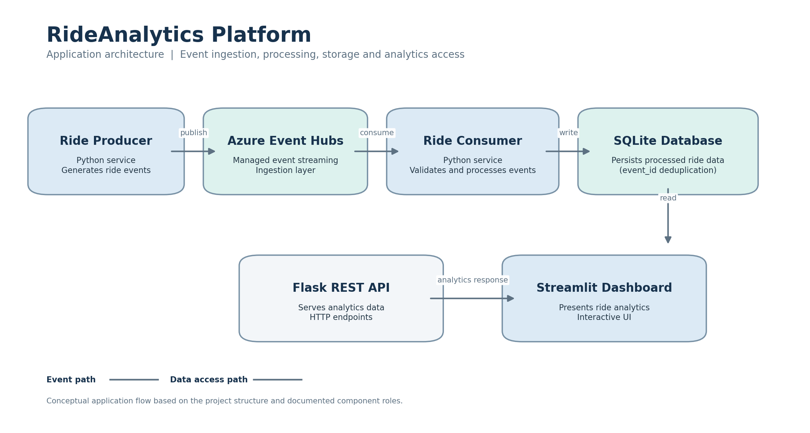
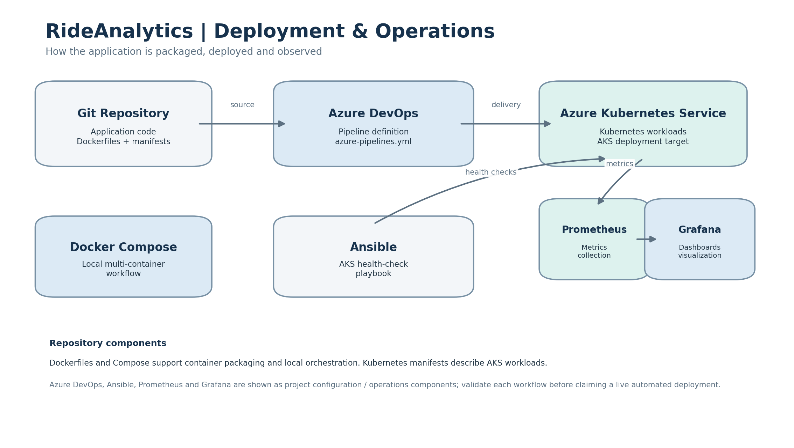

# Azure RideAnalytics Platform

An event-driven ride analytics platform built using Python, Azure Event Hubs, Docker, Kubernetes, Azure DevOps, Ansible, Prometheus and Grafana.

The project demonstrates how ride events can be generated, streamed, processed, stored and exposed through an API and dashboard. It also includes infrastructure deployment configurations, container orchestration, CI/CD pipeline definitions, automated health checks and monitoring components.

## 1. Project Overview

RideAnalytics simulates ride-booking activity and processes incoming ride events through an event-driven architecture.

A Python producer generates ride events and publishes them to Azure Event Hubs. A Python consumer receives and processes these events, with processed data stored in SQLite.

A Flask REST API provides access to analytics data, while a Streamlit dashboard presents the results.

The application is containerized using Docker and includes Kubernetes manifests for deployment to Azure Kubernetes Service (AKS).

## 2. Application Architecture



### Event Processing Flow

1. The Python producer generates simulated ride events.
2. Azure Event Hubs receives and streams the events.
3. The Python consumer reads and processes incoming events.
4. Processed ride data is persisted in SQLite.
5. The Flask API exposes analytics data through HTTP endpoints.
6. The Streamlit dashboard presents ride analytics to users.

Azure Event Hubs acts as the event-streaming layer. SQLite is used for application-level data persistence.

## 3. Deployment and Operations Architecture



The repository contains configurations for container packaging, local orchestration, Kubernetes deployment, CI/CD, operational automation and monitoring.

| Component | Purpose |
|---|---|
| Docker | Packages application services into container images |
| Docker Compose | Runs the application services together in a local environment |
| Azure Kubernetes Service | Kubernetes deployment target for application workloads |
| Azure DevOps | Defines the CI/CD pipeline |
| Ansible | Automates AKS health-check tasks |
| Prometheus | Collects metrics from configured monitoring targets |
| Grafana | Visualizes metrics through dashboards |

## 4. Technology Stack

| Category | Technology |
|---|---|
| Programming language | Python |
| Event streaming | Azure Event Hubs |
| Data processing | Python consumer |
| Database | SQLite |
| Backend API | Flask |
| Dashboard | Streamlit |
| Containerization | Docker |
| Local orchestration | Docker Compose |
| Container orchestration | Kubernetes |
| Cloud platform | Microsoft Azure |
| Kubernetes service | Azure Kubernetes Service (AKS) |
| CI/CD | Azure DevOps Pipelines |
| Configuration and operational automation | Ansible |
| Metrics monitoring | Prometheus |
| Visualization | Grafana |
| Version control | Git and GitHub |

## 5. Repository Structure

```text
RideAnalytics-DevOps/
│
├── src/
│   ├── producer/
│   │   └── ride_producer.py
│   ├── consumer/
│   │   └── ride_consumer.py
│   ├── api/
│   │   └── app.py
│   └── dashboard/
│       └── app.py
│
├── ansible/
│   ├── aks-health-check.yml
│   └── inventory.ini
│
├── k8s/
│   ├── apps.yaml
│   └── storage.yaml
│
├── monitoring/
│   ├── prometheus/
│   │   ├── prometheus.yml
│   │   └── prometheus-deployment.yaml
│   └── grafana/
│       ├── dashboard-provider.yaml
│       ├── datasource.yaml
│       ├── grafana-deployment.yaml
│       └── rideanalytics.json
│
├── tests/
│   └── test_ride_analytics.py
│
├── docs/
│   └── images/
│       ├── rideanalytics-application-architecture.png
│       └── rideanalytics-deployment-operations.png
│
├── Dockerfile.producer
├── Dockerfile.consumer
├── Dockerfile.api
├── Dockerfile.dashboard
├── docker-compose.yml
├── azure-pipelines.yml
├── requirements.txt
├── .dockerignore
├── .gitignore
└── README.md
```

The `docs/images/` directory contains the architecture diagrams used in this README.

## 6. Application Components

### 6.1 Ride Producer

**File:** `src/producer/ride_producer.py`

The producer generates simulated ride events and publishes them to Azure Event Hubs.

This component represents the event source in the application architecture.

### 6.2 Azure Event Hubs

Azure Event Hubs provides the managed event-ingestion and streaming layer.

It separates the producer from the consumer so that event generation and event processing can operate as independent services.

### 6.3 Ride Consumer

**File:** `src/consumer/ride_consumer.py`

The consumer reads incoming ride events from Azure Event Hubs and processes the data for analytics.

The processed information is stored in the SQLite database.

### 6.4 SQLite Database

**Database:** `data/ride_analytics.db`

SQLite provides persistent storage for processed ride data.

The database file is excluded from Git version control because it contains runtime-generated application data.

### 6.5 Flask REST API

**File:** `src/api/app.py`

The Flask application provides HTTP endpoints for accessing ride analytics.

It separates the analytics backend from the presentation layer.

### 6.6 Streamlit Dashboard

**File:** `src/dashboard/app.py`

The Streamlit application provides a user-facing interface for viewing ride analytics.

It allows processed ride information to be presented in a more accessible format.

## 7. Containerization with Docker

The project uses separate Dockerfiles for its application services.

| Dockerfile | Service |
|---|---|
| `Dockerfile.producer` | Ride event producer |
| `Dockerfile.consumer` | Ride event consumer |
| `Dockerfile.api` | Flask REST API |
| `Dockerfile.dashboard` | Streamlit dashboard |

This approach allows services to be built, configured and deployed independently.

### Local Docker Compose Setup

Docker Compose is used to manage the application containers in a local environment.

Build the images:

```bash
docker compose build
```

Start the services:

```bash
docker compose up -d
```

View container status:

```bash
docker compose ps
```

View service logs:

```bash
docker compose logs -f
```

Stop the services:

```bash
docker compose down
```

The required Azure Event Hubs configuration must be provided before running services that connect to Event Hubs.

## 8. Kubernetes and AKS

The repository includes Kubernetes manifests for deploying application workloads.

| File | Purpose |
|---|---|
| `k8s/apps.yaml` | Application workload configuration |
| `k8s/storage.yaml` | Storage-related Kubernetes configuration |

AKS provides the managed Kubernetes environment for the deployment target.

To apply the manifests to a configured Kubernetes cluster:

```bash
kubectl apply -f k8s/storage.yaml
kubectl apply -f k8s/apps.yaml
```

Check the workloads:

```bash
kubectl get pods
kubectl get deployments
kubectl get services
```

These commands require a configured Kubernetes context, appropriate permissions and any referenced images, secrets or storage resources.

## 9. CI/CD with Azure DevOps

**Pipeline file:** `azure-pipelines.yml`

The project includes an Azure DevOps pipeline definition to support the application delivery workflow.

The pipeline configuration is maintained in the repository alongside the application source code.

The exact build, test, image-publishing and deployment stages are defined by `azure-pipelines.yml`.

## 10. Operational Automation with Ansible

**Playbook:** `ansible/aks-health-check.yml`

Ansible is included for automated operational health checks.

The playbook provides a repeatable way to perform the checks defined in the project configuration.

The repository also includes:

```text
ansible/inventory.ini
```

This file contains the Ansible inventory configuration.

## 11. Monitoring and Observability

The project includes Prometheus and Grafana configuration files.

### Prometheus

Prometheus is used for metrics collection.

Relevant files:

```text
monitoring/prometheus/prometheus.yml
monitoring/prometheus/prometheus-deployment.yaml
```

The configuration defines the monitoring setup and deployment resources.

### Grafana

Grafana is used to visualize monitoring data.

Relevant files:

```text
monitoring/grafana/datasource.yaml
monitoring/grafana/dashboard-provider.yaml
monitoring/grafana/grafana-deployment.yaml
monitoring/grafana/rideanalytics.json
```

The repository includes a datasource configuration, dashboard provisioning configuration, Kubernetes deployment configuration and a dashboard definition.

## 12. Local Development Setup

### Prerequisites

- Python
- Git
- Docker and Docker Compose
- An Azure subscription with access to Azure Event Hubs
- Azure Event Hubs connection configuration

Kubernetes, Azure CLI and Ansible are required for their respective deployment and operational workflows.

### Clone the Repository

```bash
git clone https://github.com/<your-username>/Azure-RideAnalytics-Platform.git
cd Azure-RideAnalytics-Platform
```

Replace `<your-username>` with the GitHub account that owns the repository.

### Create a Python Virtual Environment

On Windows PowerShell:

```powershell
python -m venv .venv
.\.venv\Scripts\Activate.ps1
```

### Install Dependencies

```bash
pip install -r requirements.txt
```

### Configure Environment Variables

Create a local `.env` file with the Azure Event Hubs configuration expected by the application.

Do not commit connection strings, access keys or other credentials to GitHub.

### Run with Docker Compose

```bash
docker compose up --build -d
```

Check the services:

```bash
docker compose ps
```

Inspect the logs:

```bash
docker compose logs -f
```

## 13. Testing

The repository includes Python tests in:

```text
tests/test_ride_analytics.py
```

Run the test suite with:

```bash
python -m pytest tests/
```

Install `pytest` if it is not already available in the development environment.

## 14. Security and Configuration

The project uses environment-based configuration for services that require credentials.

Sensitive and runtime-generated files should remain outside version control.

Examples include:

```text
.env
.venv/
__pycache__/
data/*.db
```

Connection strings and access keys should be provided through local environment variables or an appropriate secrets-management mechanism.

Kubernetes secrets and CI/CD credentials should be managed separately from application source code.

## 15. Project Scope

The project brings together application development and DevOps practices in a single event-driven system.

Its main areas of focus are:

- Event-driven communication using Azure Event Hubs
- Python-based event production and consumption
- Persistent storage of processed ride data
- REST API development with Flask
- Analytics visualization with Streamlit
- Multi-service containerization with Docker
- Kubernetes deployment configurations for AKS
- CI/CD pipeline configuration with Azure DevOps
- Operational health-check automation using Ansible
- Metrics collection and visualization using Prometheus and Grafana

## 16. Future Improvements

Potential enhancements include:

- Automated integration and end-to-end tests
- More comprehensive application-level metrics
- Alerting for application and infrastructure failures
- Centralized log aggregation
- Improved secrets management
- Production-grade database and storage architecture
- Expanded deployment validation and rollback procedures

## 17. Project Purpose

RideAnalytics was developed as a practical Cloud and DevOps project to understand how independently deployed services can work together in an event-driven application.

The project combines event streaming, backend development, containerization, Kubernetes, CI/CD configuration, operational automation and monitoring in one repository.